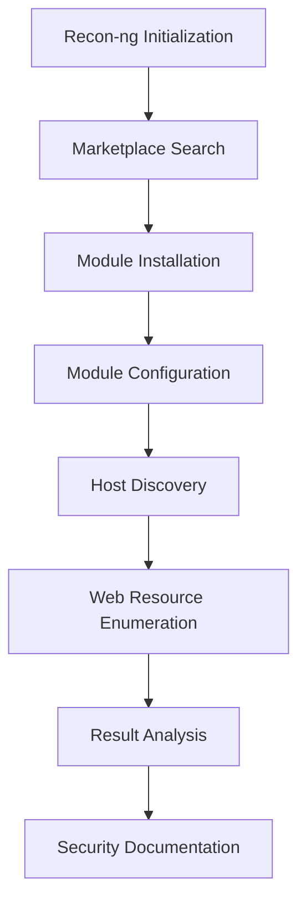

# 🔎 Recon-ng Web Reconnaissance Lab


> **Cybersecurity practical lab: reconnaissance and information gathering with Recon-ng.**

---

## 📑 Table of Contents

- [Overview](#-overview)
- [Ethical Authorization & Safety Scope](#%EF%B8%8F-ethical-authorization--safety-scope)
- [Objectives](#-objectives)
- [Tools & Environment](#%EF%B8%8F-tools--environment)
- [Workflow](#-workflow)
- [Lab Walkthrough](#-lab-walkthrough)
- [Results](#-results)
- [Analysis of Findings](#-analysis-of-findings)
- [Defensive Security Perspective](#%EF%B8%8F-defensive-security-perspective)
- [Limitations](#%EF%B8%8F-limitations)
- [Skills Demonstrated](#-skills-demonstrated)
- [Command Reference](#-command-reference)
- [Screenshots](#-screenshots)
- [Conclusion](#-conclusion)
- [Disclaimer](#%EF%B8%8F-disclaimer)

---

## 📌 Overview

This lab uses **Recon-ng**, a modular open-source reconnaissance framework, to perform controlled web reconnaissance and information gathering.

It covers:

- Recon-ng initialization
- Marketplace module discovery and installation
- Host discovery
- Web resource enumeration
- Identifying potentially interesting files
- Recording and analyzing results
- Applying ethical and safety controls during security testing

---

## ⚖️ Ethical Authorization & Safety Scope

> [!WARNING]
> This lab is intended **strictly for authorized cybersecurity education, testing, and research.** Do not use these techniques against third-party systems without permission.

### Authorization requirement

Only perform these techniques against:

- Systems you own
- Systems for which you have explicit written authorization
- Intentionally vulnerable lab environments
- CTF or training platforms that permit testing

### Safety boundaries

This exercise is limited to reconnaissance. **No attempt was made to:**

- Exploit vulnerabilities
- Obtain unauthorized access
- Bypass authentication
- Modify or delete data
- Deploy malware or establish persistence
- Conduct denial-of-service activity
- Access private information

The goal is to understand how reconnaissance tools work and how discovered information is interpreted from a **defensive** perspective.

---

## 🎯 Objectives

1. Understand the Recon-ng interface
2. Search the Recon-ng marketplace
3. Install reconnaissance modules
4. Load and configure modules
5. Perform host discovery
6. Identify web-accessible resources
7. Interpret reconnaissance results
8. Document findings professionally
9. Apply ethical testing boundaries
10. Prepare practical work for GitHub

---

## 🛠️ Tools & Environment

| Tool | Purpose |
| --- | --- |
| **Recon-ng** | Web reconnaissance framework |
| **HackerTarget module** | Host/domain discovery |
| **Interesting File Finder** | Checks for predictable web resources |
| **HackerTarget API** | Host discovery data source |
| **Kali Linux** | Security testing environment |

| Setting | Value |
| --- | --- |
| **Operating system** | Kali Linux |
| **Framework** | Recon-ng v5.1.2 |
| **Testing type** | Passive (HackerTarget) and low-impact active (Interesting File Finder) reconnaissance |
| **Target** | `korlinktech.com` |
| **Purpose** | Educational lab exercise |

---

## 🔄 Workflow



---

## 🧪 Lab Walkthrough

### 1. Starting Recon-ng

```bash
recon-ng
help
```

Key commands: `marketplace`, `modules`, `options`, `info`, `load`, `run`.

### 2. Exploring the marketplace

```bash
marketplace search
```

The marketplace returns modules covering domains, hosts, credentials, contacts, metadata, information disclosure, and vulnerability discovery. Users install only the modules they need.

### 3. Installing the HackerTarget module

```bash
marketplace search hackertarget
marketplace install recon/domains-hosts/hackertarget
```

### 4. Loading and inspecting the module

```bash
modules load recon/domains-hosts/hackertarget
info
```

**HackerTarget Lookup** uses the HackerTarget service to identify host information and update the Recon-ng hosts database.

### 5. Configuring the target and running

```bash
options set SOURCE korlinktech.com
run
```

### 6. Installing Interesting File Finder

```bash
marketplace install discovery/info_disclosure/interesting_files
modules load discovery/info_disclosure/interesting_files
info
options set SOURCE korlinktech.com
run
```

This module checks hosts for files and resources at predictable paths.

---

## 📊 Results

### Host discovery

| Host | IP Address |
| --- | --- |
| `korlinktech.com` | `104.21.23.191` |

```text
1 total (1 new) hosts found.
```

### Web resource enumeration

| Resource | Result |
| --- | --- |
| `/robots.txt` | ✅ **200 – Found** |
| `/sitemap.xml` | ❌ 404 – Not Found |
| `/sitemap.xml.gz` | ❌ 404 – Not Found |
| `/crossdomain.xml` | ⚠️ Error |
| `/phpinfo.php` | ⚠️ Error |
| `/test.php` | ⚠️ Error |
| `/elmah.axd` | ❌ 404 – Not Found |
| `/server-status` | ⚠️ Error |
| `/jmx-console/` | ⚠️ Error |
| `/admin-console/` | ❌ 404 – Not Found |
| `/web-console/` | ❌ 404 – Not Found |

```text
1 interesting files found
```

The discovered resource was downloaded to the Recon-ng workspace.

---

## 🔎 Analysis of Findings

**Host discovery:** HackerTarget identified `korlinktech.com` at `104.21.23.191`, giving an initial view of the target's externally observable infrastructure without any exploitation.

**Web resource discovery:** Only `/robots.txt` returned `200 OK`. All other tested paths returned `404 Not Found` or errors.

Predictable web resources can reveal information about:

- Website structure
- Crawling restrictions
- Administrative paths
- Application technologies
- Development artifacts
- Server configuration

> [!NOTE]
> The existence of a resource does **not** by itself indicate a vulnerability. Further investigation requires explicit authorization and appropriate validation.

---

## 🛡️ Defensive Security Perspective

Organizations should know what is publicly discoverable about their infrastructure. Security teams can use similar techniques to find:

- Unexpected exposed hosts
- Publicly accessible files
- Forgotten development resources
- Administrative interfaces
- Unnecessary information disclosure
- Incorrect web-server configurations

### Recommended security controls

| # | Control | Description |
| --- | --- | --- |
| 1 | **Minimize public exposure** | Expose only services required for business operations. |
| 2 | **Remove unnecessary files** | Keep files like `phpinfo.php` and `test.php` off production systems. |
| 3 | **Review web server configuration** | Don't expose administrative interfaces to the public Internet. |
| 4 | **Monitor external attack surface** | Periodically inventory domains, subdomains, IPs, services, web apps, and public files. |
| 5 | **Apply least privilege** | Require authentication and authorization for administrative resources. |
| 6 | **Conduct authorized assessments** | Run regular vulnerability assessments and penetration tests. |

---

## ⚠️ Limitations

- **Limited scope:** reconnaissance only, no exploitation or vulnerability validation
- **Single target:** only one domain was examined
- **Limited module coverage:** only selected Recon-ng modules were used
- **No exploitation:** no discovered resource was exploited
- **Reconnaissance ≠ vulnerability:** finding a hostname, IP, or file does not mean the system is vulnerable

---

## 🧠 Skills Demonstrated

`Recon-ng` • `OSINT fundamentals` • `Passive reconnaissance` • `Host discovery` • `Domain reconnaissance` • `Web enumeration` • `Information disclosure analysis` • `Module management` • `Security documentation` • `Ethical hacking methodology` • `Attack-surface awareness`

---

## 📝 Command Reference

```bash
# Start Recon-ng
recon-ng

# Display help
help

# Search the marketplace
marketplace search
marketplace search hackertarget

# Install, load, and inspect a module
marketplace install recon/domains-hosts/hackertarget
modules load recon/domains-hosts/hackertarget
info

# Configure target and execute
options set SOURCE korlinktech.com
run
```

<details>
<summary><b>Interesting File Finder commands</b></summary>

```bash
marketplace install discovery/info_disclosure/interesting_files
modules load discovery/info_disclosure/interesting_files
info
options set SOURCE korlinktech.com
run
```

</details>

---

## 📸 Screenshots

<!-- Add your screenshots to the screenshots/ folder, then uncomment the lines below. -->

<!--


-->

---

## ✅ Conclusion

This practical showed how Recon-ng works as a structured framework for collecting publicly observable information, from initialization through module configuration to result analysis and documentation.

> **Reconnaissance provides information; that information must be interpreted carefully before drawing security conclusions.**

All reconnaissance should be conducted within an explicitly authorized scope.

---

## ⚠️ Disclaimer

This repository is provided for **educational and authorized cybersecurity testing purposes only**. The techniques demonstrated must not be used against systems, networks, or applications without appropriate authorization. The author does not encourage unauthorized access, exploitation, disruption, or misuse of security tools.

---

## 👨‍💻 Author

**Godwin**

**Focus areas:** `Reconnaissance` • `OSINT` • `Network Security` • `Web Security` • `Ethical Hacking` • `Information Gathering`

> *Learn the technique. Understand the risk. Practice ethically. Document professionally. Defend effectively.*
